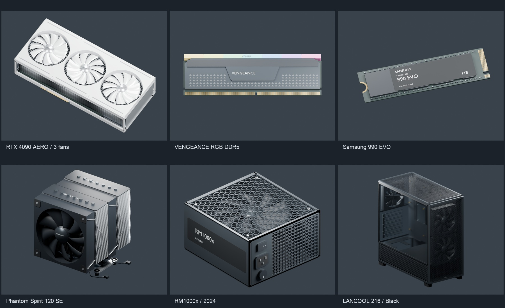
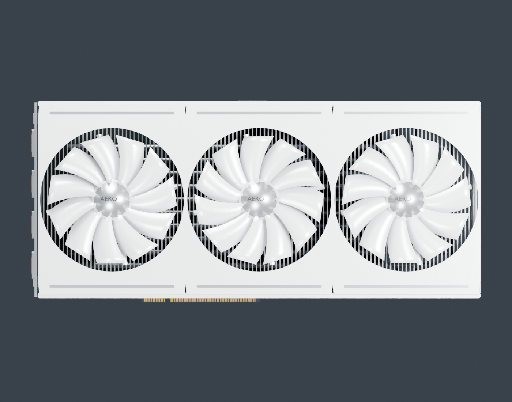
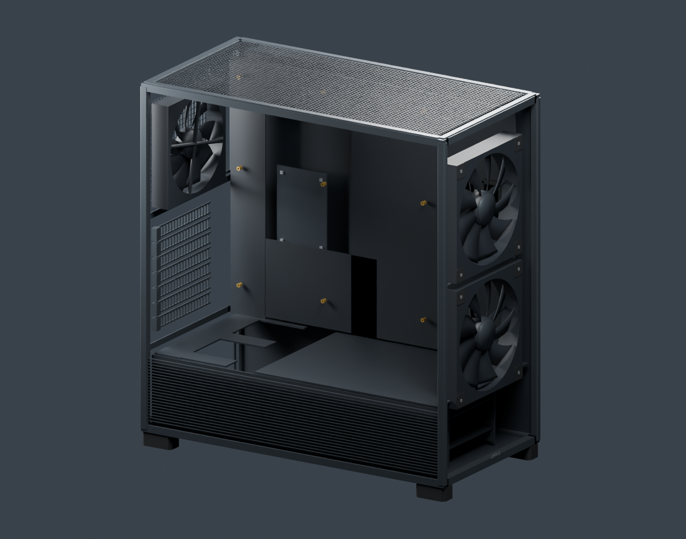

# 六类零配件首版模型审核单

2026-09-20。按已确认的型号，通过 Blender + 本地 blender-mcp 建模，生成独立源文件、GLB 和多角度预览。



| 配件 | 型号 | 三角形 | GLB大小 | 文件 |
|---|---|---:|---:|---|
| [02 · 显卡](../gpu/README.md) | GIGABYTE RTX 4090 AERO OC 24G · 银白色 | 13,968 | 0.54 MB | [Blend](../gpu/gpu.blend) / [GLB](../gpu/gpu.glb) |
| [01 · 内存](../ram/README.md) | CORSAIR VENGEANCE RGB DDR5 · 灰黑色 | 7,121 | 0.39 MB | [Blend](../ram/ram.blend) / [GLB](../ram/ram.glb) |
| [03 · SSD](../ssd/README.md) | Samsung 990 EVO 1TB · M.2 2280 | 3,348 | 0.16 MB | [Blend](../ssd/ssd.blend) / [GLB](../ssd/ssd.glb) |
| [04 · 风冷散热器](../cooler/README.md) | Thermalright Phantom Spirit 120 SE | 19,828 | 0.79 MB | [Blend](../cooler/cooler.blend) / [GLB](../cooler/cooler.glb) |
| [05 · 电源](../psu/README.md) | CORSAIR RM1000x · 2024 · 黑色 | 38,173 | 1.85 MB | [Blend](../psu/psu.blend) / [GLB](../psu/psu.glb) |
| [06 · 机箱](../case/README.md) | LIAN LI LANCOOL 216X · 黑色无光版 | 15,975 | 0.65 MB | [Blend](../case/case.blend) / [GLB](../case/case.glb) |

## 显卡风扇核对

显卡是三风扇版本，模型中三套风扇及各自转子均存在，中间转子记录相反转向。原先 wind/card.png 是官网动画使用的分层素材，已从整卡外观参考中移除。[官方三风扇说明](https://www.gigabyte.com/Graphics-Card/GV-N4090AERO-OC-24GD)。



## 装机相关结构

- 内存防呆缺口、M.2尾部半圆缺口、显卡PCIe缺口为真实几何，均完成射线穿孔检查。
- 散热器双风扇竖直安装，含四个独立钢丝扣、AM5支架/垫柱、弹簧螺丝、底部保护膜、PWM线。
- 电源带模块插座、AC入口、拨动开关和风扇控制旋钮；插座内部不是电气接线图。
- 机箱含前后风扇、可拆侧板/前板/顶板、七片扩展挡板、铜柱、硬盘托架、前面板线缆定位点。



## 当前边界

这是供外观与装配结构审核的第一版，不是精密扫描件。风扇叶型、冲孔图案、隐藏内部结构和部分扣具尺寸采用简化重建。尚未把六件组合为通过碰撞测试的整机；尤其是散热器前风扇与内存净空、主板铜柱图和机箱I/O位置，需要接入时一起校准。网站没有替换模型或启动服务。

## 验证与复现

所有GLB通过项目Three.js加载、有限数值、网格索引、单根场景、部件数量与关键缺口检查；没有相机/灯光或外部贴图混入GLB。全部Blend文件重新打开，设置了便于查看的视角，保存为普通Blender文档。尚未测试Windows集成显卡上的整机场景帧率。

构建入口：`scripts/blender/build_remaining_parts.py` 的 `build(key)`，在Blender MCP中执行；每个配件独立调用。之后执行：

```sh
node scripts/blender/validate_parts.mjs
/Applications/Blender.app/Contents/MacOS/Blender --background --python scripts/blender/finalize_blend_parts.py
```

[完整验证数据](manifest.json) · [参考图及来源](../../docs/model-references/README.md)

## 网站接入更新 · 2026-09-20

已接入货架与工作台。原文“未接入”描述的是建模交付时状态；当前运行时适配、教学简化及验证范围见[接入记录](../../docs/model-integration.md)。
