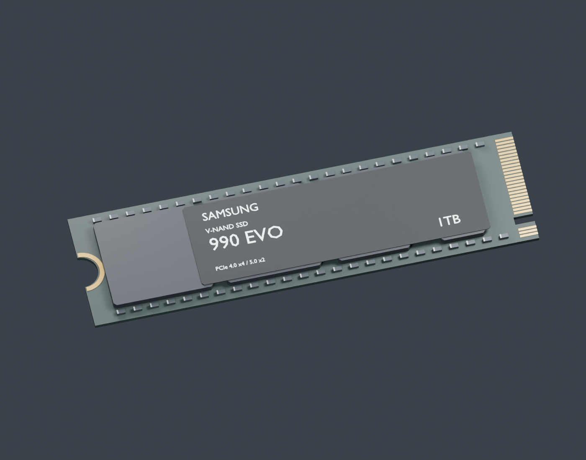

# Samsung 990 EVO 1TB · M.2 2280

2026-09-20 · 首版参考建模 · Blender 5.2 + 本地 blender-mcp

[Blender 源文件](ssd.blend) · [GLB](ssd.glb) · [验证结果](validation.json)

[back](previews/back.png) · [front](previews/front.png) · [hero](previews/hero.png)

## 内容与准确度

- 80 × 22 mm PCB; package thickness approximated from photographs.
- M-key and half-round tail are physical geometry. Label is distinct from removable motherboard thermal-pad film.
- Brand text is reconstructed geometry; regulatory symbols and serial numbers are intentionally omitted.

## 接入约定

- glTF 使用米；Blender 坐标转换为 glTF `(x,z,-y)`。
- 单一模型根节点；风扇转子、可拆部件及 ANCHOR 节点保持独立。名字与属性见 model-manifest.json。
- 部件可拆分是建模准备，不代表网站已经实现这些交互。
- 本次没有修改已有装机流程、安装顺序或网站代码。
- 接入前需要统一各资产坐标、安装位与碰撞代理，并验证高内存与散热器前风扇的净空。

## 来源与验证

[官方产品来源](https://www.samsung.com/sec/memory-storage/990-evo-ssd/MZ-V9E1T0BW/) · [参考记录](reference/sources.json)

Three.js 实际加载通过；13 个网格、3,348 个三角形；Blender 文件重新打开并保存为独立文档。

几何由脚本生成；没有解包或导入 assets 下第三方 ZIP 模型，参考照片没有用作 GLB 纹理。品牌文字是视觉识别细节，来源记录不构成素材授权证明。

## 网站接入更新 · 2026-09-20

已接入货架与工作台。原文“未接入”描述的是建模交付时状态；当前运行时适配、教学简化及验证范围见[接入记录](../../docs/model-integration.md)。
